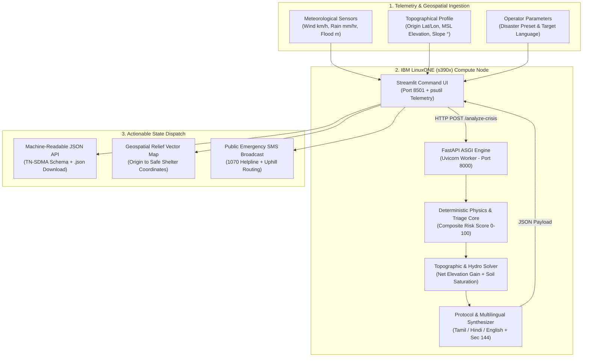
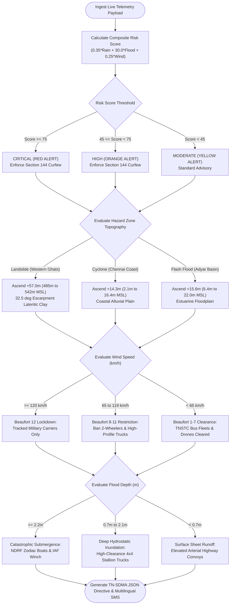
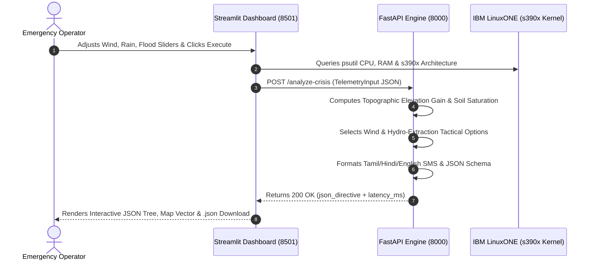

# 🏗️ Evac AI: System Architecture & Decision Flowchart
**Team Z-etta Bytes** | *IBM Z Datathon — Real-Time AI for Critical Decisions*

---

## 1. End-to-End System Architecture (`s390x`)

---

## 2. Solution Decision Flowchart (Physics & Triage Logic)

---

## 3. Request / Response Sequence Flow

