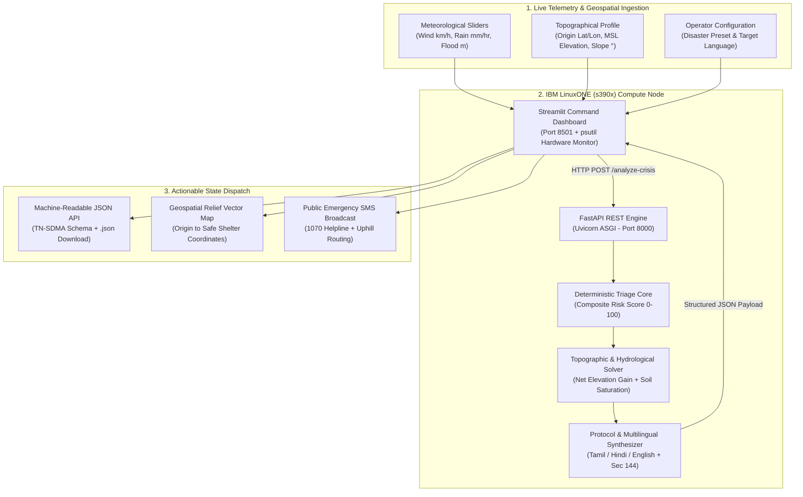

# 🚨 Evac AI: Anticipatory Disaster Response & Topographic Triage Platform
**Team Z-etta Bytes** | **IBM Z Datathon 2026**  
*Track: Real-Time AI for Critical Decisions / AI for Climate Action*

-052FAD?style=for-the-badge&logo=ibm&logoColor=white)


---

## 📌 1. Executive Summary & Problem Statement

During rapid-onset climate disasters—such as coastal cyclones, estuarine flash floods, and escarpment landslides—traditional emergency alert systems rely on slow, static, one-size-fits-all warnings. Telling citizens to simply *"evacuate immediately"* without accounting for ground physics leads to catastrophic bottlenecks:
1. **Topographical Blindness:** Citizens flee into low-lying alluvial basins or unstable shear slopes because alerts lack Mean Sea Level (MSL) elevation vectors and slope gradient thresholds.
2. **Tactical Fleet Failures:** Standard civilian buses are dispatched into gale-force crosswinds (risking aerodynamic overturning) or deep hydrostatic inundation (stalling engines and trapping evacuees).
3. **Last-Mile Communication & Integration Gaps:** Public broadcasts often lack localized vernacular instructions (Tamil/Hindi) with exact safe-haven coordinates, while emergency command centers lack standardized, machine-readable JSON outputs to automate National/State Disaster Response Force (NDRF/SDRF) dispatch.

**Evac AI** solves this by executing a **Deterministic Topographic & Meteorological Triage Engine** natively on **IBM Z / LinuxONE (`s390x`)**. Ingesting live weather telemetry alongside geological zone profiles, the platform computes real-time risk scores, required uphill elevation gains, soil saturation limits, wind/flood vehicle restrictions, standardized `TN-SDMA` JSON directives, and localized multilingual SMS broadcasts.

---

## 🖥️ 2. Why IBM Z / LinuxONE (`s390x`)?

Disaster response infrastructure cannot afford server downtime, I/O bottlenecks, or nondeterministic hallucinations during a Category-4 cyclone or flash flood. Evac AI leverages the **IBM LinuxONE (`s390x`)** architecture for three mission-critical reasons:
* **Extreme Reliability & Availability:** Mainframe-grade hardware fault tolerance ensures continuous operation when regional cloud nodes experience disruption during severe weather events.
* **High-Throughput Telemetry Ingestion:** The decoupled `FastAPI` + `Uvicorn` ASGI backend on `s390x` is architected to process thousands of concurrent meteorological sensor feeds and citizen triage requests with minimal latency.
* **Deterministic Auditability & Hardware Telemetry:** Unlike black-box generative models that can hallucinate coordinates during life-or-death emergencies, Evac AI runs auditable physics and hydrological heuristics while monitoring real-time `s390x` CPU and memory utilization via `psutil`.

---

## 🏗️ 3. System Architecture & Decision Flow



---

## 🧮 4. Mathematical & Physics Models

Evac AI evaluates three interconnected physical models on every API call:

### A. Composite Hazard Triage Score ($0 - 100$)
The engine weights rainfall intensity ($R$ in $\text{mm/hr}$), hydrostatic inundation depth ($F$ in $\text{meters}$), and wind velocity ($W$ in $\text{km/h}$):

$$\text{Risk Score} = \min\left(100.0,\ \text{round}\big((0.35 \times R) + (30.0 \times F) + (0.25 \times W),\ 1\big)\right)$$

* **$\text{Score} \ge 75.0$:** `CRITICAL (RED ALERT)` — Mandatory evacuation & Section 144 Curfew active.
* **$45.0 \le \text{Score} < 75.0$:** `HIGH (ORANGE ALERT)` — Pre-emptive evacuation & Section 144 Curfew active.
* **$\text{Score} < 45.0$:** `MODERATE (YELLOW ALERT)` — Standard advisory & monitoring.

### B. Urban Stormwater Drainage Surplus
Calculates the exact rate at which precipitation exceeds the local terrain's natural and engineered drainage capacity ($D_{\text{threshold}}$):

$$\text{Drainage Surplus (mm/hr)} = \max\big(0.0,\ R - D_{\text{threshold}}\big)$$

### C. Geological Soil Saturation & Slope Shear Stability
Models pore-water pressure accumulation in soil layers to predict escarpment landslide shear failure:

$$\text{Soil Saturation (\%)} = \min\left(100.0,\ \text{round}\big(45.0 + (0.25 \times R) + (8.0 \times F),\ 1\big)\right)$$

* When **$\text{Soil Saturation} \ge 80\%$** on steep escarpments ($>30^\circ$ slope), geological stability shifts to **`IMMINENT SHEAR FAILURE`**, rerouting evacuees away from valley thalwegs.

---

## ⛰️ 5. Topographical & Geological Zone Profiles

Evac AI includes three calibrated disaster presets modeled on real-world Tamil Nadu geomorphology:

| Parameter | Scenario 1: Chennai Coastal Cyclone Surge | Scenario 2: Adyar River Basin Flash Flood | Scenario 3: Coimbatore Western Ghats Landslide |
| :--- | :--- | :--- | :--- |
| **Origin Coordinates** | `13.0827, 80.2707` | `13.0012, 80.2565` | `11.0168, 76.9558` |
| **Safe Shelter Coordinates** | `13.1177, 80.2257` | `13.0332, 80.2315` | `11.0448, 76.9878` |
| **Designated Shelter** | Egmore High-Ground Multi-Storey Cyclone Bunker | Guindy Elevated Relief & Medical Complex | Thondamuthur Bedrock Plateau Command Camp |
| **Origin Elevation (MSL)** | `2.1 m` | `6.4 m` | `485.0 m` |
| **Shelter Elevation (MSL)** | `16.4 m` | `22.0 m` | `542.0 m` |
| **Required Uphill Gain** | **`+14.3 m`** | **`+15.6 m`** | **`+57.0 m`** |
| **Terrain Classification** | Low-Lying Coastal Alluvial Plain | Estuarine Riverine Floodplain | Steep Lateritic Escarpment |
| **Slope Gradient** | `0.8°` | `1.4°` | `32.5°` |
| **Soil Composition** | Saturated Marine Alluvial Sand | Impervious Urban Clayey Silt | Weathering Lateritic Clay over Gneiss Bedrock |
| **Drainage Threshold** | `45.0 mm/hr` | `55.0 mm/hr` | `75.0 mm/hr` |

---

## 🚛 6. Dynamic Tactical Evacuation Matrices

Every change to the **Wind Speed** or **Flood Depth** sliders dynamically alters the state-mandated logistics protocol:

### A. Aerodynamic Wind Velocity Rules
| Wind Speed ($W$) | Beaufort Scale Classification | Mandated Tactical Protocol |
| :--- | :--- | :--- |
| **$\ge 120\text{ km/h}$** | Cyclonic Super-Gale (Beaufort 12) | **Extreme Wind Lockdown:** High overturning risk for buses/ambulances. Halt all flyover transit; deploy low-center-of-gravity tracked armored carriers or enforce vertical concrete core sheltering. |
| **$65 - 119\text{ km/h}$** | Severe Gale Force (Beaufort 8–11) | **High Wind Corridor Restriction:** Ban two-wheelers and high-profile canvas trucks. Reroute convoys through wind-shielded inland avenues; guard against snapping 11kV cables. |
| **$< 65\text{ km/h}$** | Moderate Breeze (Beaufort 1–7) | **Standard Aerodynamic Clearance:** TNSTC state bus fleets, medical ambulances, and aerial surveillance drones cleared for rapid transit. |

### B. Hydrostatic Inundation & Mobility Rules
| Water Depth ($F$) | Hydro-Mobility Classification | Mandated Extraction Mode & Agency Deployment |
| :--- | :--- | :--- |
| **$\ge 2.2\text{ m}$** | Catastrophic Submergence | **Wheeled Transit Impossible:** Ground floor inundated. Activate **NDRF Inflatable Zodiac Boat** corridors and **Indian Air Force (IAF) rotary-wing rooftop winch** extraction. |
| **$0.7 - 2.1\text{ m}$** | Deep Hydrostatic Inundation | **Heavy High-Clearance Extraction Only:** Civilian cars will float/stall. Restrict transit strictly to **NDRF/SDRF 4x4 Ashok Leyland Stallion trucks** and tractor-trailers. |
| **$< 0.7\text{ m}$** | Surface Sheet Runoff | **Wheeled Convoy Clearance:** Crown of elevated arterial highways remains passable. Execute rapid civilian and state bus convoy movement; barricade dipped railway underpasses. |

---

## 📄 7. Sample Machine-Readable JSON Directive (`TN-SDMA` Schema)

The dashboard provides a one-click **`.json` file download** alongside a live syntax-highlighted preview for seamless integration with State Disaster Management Authority (SDMA) automated pipelines:

```json
{
  "directive_id": "TN-SDMA-1760740215",
  "timestamp_utc": "2026-10-18T04:30:15Z",
  "compute_node": {
    "platform": "IBM LinuxONE (s390x)",
    "architecture": "s390x",
    "inference_latency_ms": 2803.4,
    "engine_mode": "Deterministic Geospatial & Topographic Triage v2.4"
  },
  "hazard_assessment": {
    "zone_name": "Chennai Coastal Cyclone Surge",
    "composite_risk_score": 100.0,
    "alert_classification": "CRITICAL (RED ALERT)",
    "section_144_curfew_active": true
  },
  "topography_and_geology": {
    "origin_coordinates": { "lat": 13.0827, "lon": 80.2707 },
    "safe_shelter_coordinates": { "lat": 13.1177, "lon": 80.2257 },
    "shelter_name": "Egmore High-Ground Multi-Storey Cyclone Bunker",
    "origin_elevation_msl_m": 2.1,
    "shelter_elevation_msl_m": 16.4,
    "net_elevation_gain_required_m": 14.3,
    "terrain_type": "Low-Lying Coastal Alluvial Plain (Coromandel Coast)",
    "slope_gradient_degrees": 0.8,
    "soil_composition": "Saturated Marine Alluvial Sand",
    "soil_saturation_index_pct": 83.7,
    "geological_stability": "STABLE FLATLAND / HIGH HYDRO-RUNOFF"
  },
  "meteorological_telemetry_options": {
    "wind_speed_kmh": 95.0,
    "wind_scale_classification": "Severe Gale Force ( Beaufort Scale 8-11 )",
    "rainfall_intensity_mm_hr": 110.0,
    "stormwater_drainage_surplus_mm_hr": 65.0,
    "water_inundation_depth_m": 1.4,
    "hydro_mobility_status": "Deep Hydrostatic Inundation (Civilian Vehicles Stalled)"
  },
  "public_broadcast_dispatch": {
    "target_language": "Tamil and English",
    "emergency_helpline": "1070 / 112",
    "broadcast_message": "[TN GOVT ALERT - EVAC AI] CRITICAL (RED ALERT): Chennai Coastal Cyclone Surge பகுதியில் 110.0mm/hr மழை, 95.0km/h காற்று மற்றும் 1.4m நீர்மட்டம் பதிவாகியுள்ளது. உடனடியாக +14.3m உயரத்தில் உள்ள அரசு பாதுகாப்பு முகாமிற்கு (13.1177, 80.2257) செல்லவும். அவசர உதவி: 1070."
  }
}
```

---

## 📂 8. Repository Structure

```text
evac-ai-linuxone/
├── app.py                        # Streamlit Geospatial Command Dashboard & JSON Downloader (Port 8501)
├── backend.py                    # FastAPI Topographic & Meteorological Triage Engine (Port 8000)
├── requirements.txt              # Python package dependencies for s390x environment
├── ARCHITECTURE.md               # Mermaid system architecture, decision trees, and sequence diagrams
├── README.md                     # Comprehensive project documentation for Datathon evaluation
└── evac_ai_pitch_deck.pdf        # Executive Pitch Deck & Technical Architecture Dossier
```

---

## 🚀 9. Installation & Deployment on IBM LinuxONE (`s390x`)

### Prerequisites
* An **IBM LinuxONE (`s390x`)** virtual machine running Ubuntu/RHEL/SLES.
* `Miniforge` / `Conda` environment with Python 3.10+.

### Step 1: Clone the Repository & Install Dependencies
```bash
git clone [https://github.com/YOUR_USERNAME/evac-ai-linuxone.git](https://github.com/YOUR_USERNAME/evac-ai-linuxone.git)
cd evac-ai-linuxone
conda create -n evac_ai_env python=3.11 -y
conda activate evac_ai_env
pip install -r requirements.txt
```

### Step 2: Launch the FastAPI Triage Engine (Port 8000)
```bash
nohup uvicorn backend:app --host 127.0.0.1 --port 8000 > backend.log 2>&1 &
```

### Step 3: Launch the Streamlit Command Dashboard (Port 8501)
```bash
streamlit run app.py --server.port 8501 --server.address 0.0.0.0
```

### Step 4: Access via Local SSH Port-Forwarding
From your local workstation terminal, establish an encrypted tunnel to view the live dashboard at `http://localhost:8501`:
```bash
ssh -L 8501:127.0.0.1:8501 -i path/to/key.pem linux1@<LINUXONE_IP>
```
